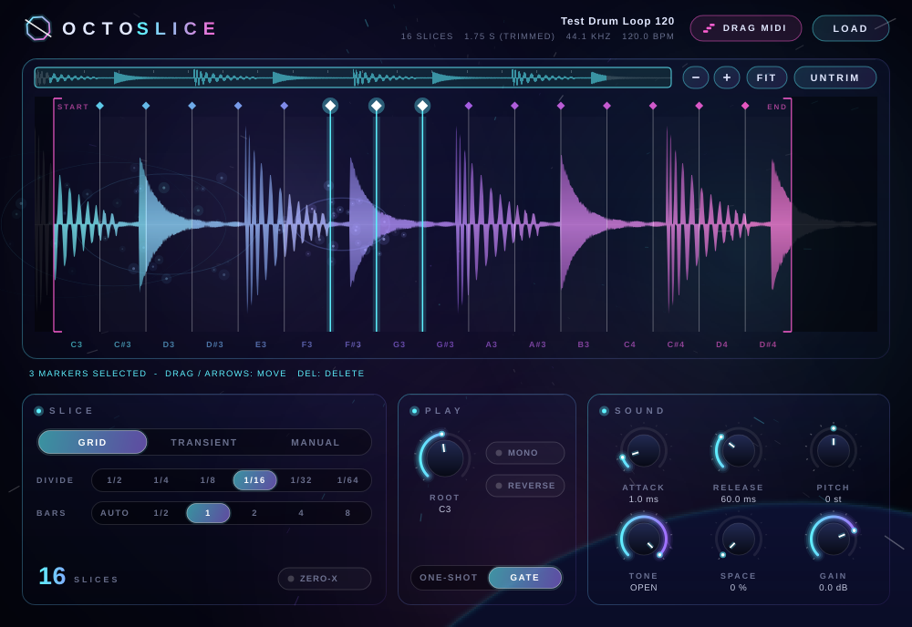

# OctoSlice

**Sample slicer instrument (VST3) — by OctoBio**

Glisse un sample, découpe-le (grille, transitoires ou à la main), puis rejoue chaque découpe au clavier pour recréer une mélodie ou un beat dans ton DAW. Interface épurée, ambiance spatiale : le fond étoilé, les nébuleuses et les particules réagissent au son et aux réglages.



## Fonctions

**Découpe**
- **Grid** : découpe régulière 1/2, 1/4, 1/8, 1/16, 1/32, 1/64, sur une longueur de sample de 1/2 à 8 mesures — ou **Auto** (calculée à partir du tempo du DAW).
- **Transient** : détection automatique des attaques (spectral flux + énergie), réglages *Sensitivity* et *Min length*.
- **Manual** : double-clic sur la forme d'onde pour ajouter une découpe, glisser un marqueur pour le déplacer, clic droit (ou Alt-clic) pour le supprimer. Toucher un marqueur en mode Grid/Transient bascule automatiquement en Manual en gardant les découpes existantes.
- **Zero-X** : cale les découpes sur le passage par zéro le plus proche (pas de clics).
- **Sélection multiple** : glisse sur une zone vide pour sélectionner plusieurs marqueurs au lasso (ou Shift-clic), puis déplace-les tous ensemble, aux flèches ou à la souris. Suppr / clic droit pour les effacer d'un coup.
- **Trim début/fin** : déplace les crochets roses START / END pour couper les silences, ou clique **AUTO TRIM** (détection automatique). Les découpes et l'export MIDI se font dans la zone gardée.
- **Zoom précis** : molette, boutons − / + / FIT, barre de navigation en haut (glisser pour se déplacer). Zoom jusqu'à l'échantillon près, avec affichage de la position en ms pendant le déplacement.

**Jeu**
- Une découpe par touche, à partir de la note **ROOT** (C3 par défaut — convention Bitwig/FL), jusqu'à 128 découpes.
- **One-shot** (la découpe joue jusqu'au bout) ou **Gate** (s'arrête au relâchement de la touche).
- **Mono** : chaque nouvelle découpe coupe la précédente (comportement slicer classique). Sinon polyphonique (16 voix).
- **Reverse**, **Pitch** (±24 demi-tons), enveloppe **Attack / Release**, filtre **Tone**, réverbe **Space**, **Gain**.
- Clic sur une découpe = pré-écoute directe dans le plugin.

**DAW**
- **DRAG MIDI** : glisse ce bouton sur une piste de ton DAW → un clip MIDI avec une note par découpe, au timing d'origine (tempo du DAW). Tu n'as plus qu'à réarranger les notes.
- Le sample est **sauvegardé dans le projet** (jusqu'à 90 s, compressé en FLAC) : rien ne casse si tu déplaces le fichier d'origine.

## Installation (Windows)

1. Va dans l'onglet **Actions** (ou **Releases**) du dépôt et télécharge `OctoSlice-Windows-x64.zip`.
2. Copie le dossier `OctoSlice.vst3` dans `C:\Program Files\Common Files\VST3\`.
3. Dans Bitwig : *Settings → Locations → Plug-ins*, relance un scan si besoin. OctoSlice apparaît dans les instruments (OctoBio).

`OctoSlice.exe` est une version autonome pour tester sans DAW.

## Compiler soi-même

```bash
cmake -B build -DCMAKE_BUILD_TYPE=Release        # télécharge JUCE 8.0.15 automatiquement
cmake --build build --config Release --target OctoSlice_VST3
```

Tests hors-ligne (découpe, lecture, sauvegarde d'état, export MIDI, captures de l'UI) :

```bash
cmake -B build -DOCTOSLICE_BUILD_TESTS=ON && cmake --build build --target OctoSliceTests
./build/OctoSliceTests_artefacts/Release/OctoSliceTests
```

Validé avec [pluginval](https://github.com/Tracktion/pluginval) au niveau de rigueur 7.

## Raccourcis

| Action | Geste |
|---|---|
| Charger un sample | glisser-déposer n'importe où, ou bouton LOAD |
| Écouter une découpe | clic |
| Ajouter une découpe | double-clic |
| Sélectionner plusieurs marqueurs | glisser sur une zone vide (lasso), Shift-clic, Ctrl+A |
| Déplacer la sélection | glisser un marqueur sélectionné, ou flèches (Shift = plus grand pas) |
| Supprimer | Suppr / clic droit / Alt-clic |
| Couper début / fin | crochets START / END, ou AUTO TRIM |
| Zoom | molette, − / + / FIT, touches + − 0 |
| Défilement | barre de navigation en haut, Maj + molette |

## Licence

Construit avec [JUCE](https://juce.com) — distribué sous licence **AGPL-3.0** (voir `LICENSE`).
